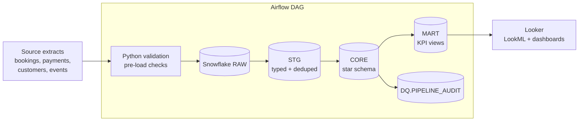
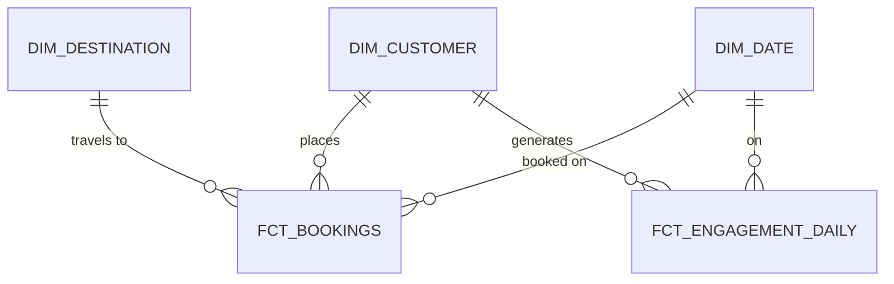

# Enterprise Revenue & Traveler Analytics Platform

An end-to-end analytics platform that integrates **booking, revenue, customer, and traveler-engagement** data into a governed **Snowflake** star schema, orchestrated with **Apache Airflow**, validated automatically, and served to executives through **Looker (LookML)** dashboards.


> **Note:** All data is synthetic, generated by `scripts/generate_synthetic_data.py`. No real customer or company data is included.

---

## Business Problem

Revenue, booking, and traveler-engagement metrics typically live in separate systems, so each team reports slightly different numbers. This project answers:

- What is **net revenue** (captured payments minus refunds), and how is it trending month over month?
- Which **destinations, regions, and booking channels** drive the most value?
- Where do travelers **drop off** between searching and booking, by acquisition channel?
- Which customers are **repeat bookers**, and what is their lifetime value?

## Architecture



**Layers**

| Layer | Schema | Purpose |
|---|---|---|
| Raw | `RAW` | Source data landed as-is via internal stage + `COPY INTO` |
| Staging | `STG` | Type casting, standardization, deduplication (`QUALIFY ROW_NUMBER()`) |
| Core | `CORE` | Dimensional model: `DIM_DATE`, `DIM_CUSTOMER`, `DIM_DESTINATION`, `FCT_BOOKINGS`, `FCT_ENGAGEMENT_DAILY` |
| Mart | `MART` | KPI views with window-function logic (MoM growth, rolling averages, ranks) |
| Audit | `DQ` | Persisted results of every post-load validation check |

## Data Model



- `FCT_BOOKINGS` grain: **one row per booking** (gross, captured, refunded, net revenue, lead time, length of stay)
- `FCT_ENGAGEMENT_DAILY` grain: **one row per customer per day**

See [`docs/data_dictionary.md`](docs/data_dictionary.md) and [`docs/kpi_definitions.md`](docs/kpi_definitions.md).

## Key Features

- **Dimensional modeling** with declared grain, surrogate keys, and a conformed date dimension
- **Advanced SQL**: CTEs, window functions (`LAG`, `RANK`, rolling frames), `QUALIFY`, conditional aggregation
- **Automated validation** at two points: Python pre-load checks and in-warehouse post-load checks
- **Source-to-target reconciliation**: row counts after load and a revenue tie-out between staging and core
- **Airflow DAG** with retries, fail-fast validation gates, and clear task dependencies
- **Looker semantic layer**: governed measures (`net_revenue`, `cancellation_rate`, `avg_booking_value`) defined once and reused
- **Tested**: pytest suite proves the validators pass on clean data and catch injected defects

## Tech Stack

Snowflake · SQL · Python (pandas, NumPy) · Apache Airflow · Looker / LookML · pytest

## Repository Structure

```
.
├── airflow/dags/revenue_traveler_pipeline.py   # orchestration
├── looker/
│   ├── travel_analytics.model.lkml
│   ├── views/                                  # fct_bookings, dim_*
│   └── dashboards/executive_overview.dashboard.lookml
├── scripts/
│   ├── generate_synthetic_data.py              # reproducible sample data
│   └── run_local_validation.py                 # validate without Snowflake
├── sql/snowflake/                              # 00_setup ... 05_post_load_checks
├── src/pipeline/                               # config, validation, Snowflake client
├── tests/test_validation.py
└── docs/
```

## Getting Started

### 1. Install

```bash
git clone https://github.com/<your-username>/enterprise-revenue-traveler-analytics.git
cd enterprise-revenue-traveler-analytics
python -m venv .venv && source .venv/bin/activate
pip install -r requirements.txt
cp .env.example .env     # add your Snowflake credentials
```

### 2. Generate data and validate locally (no Snowflake needed)

```bash
python scripts/generate_synthetic_data.py --customers 5000
python scripts/run_local_validation.py
pytest -q
```

Add `--inject-defects` to the generator to see the validation framework flag duplicates, nulls, and negative amounts.

### 3. Run in Snowflake

Run the SQL files in order from a worksheet or SnowSQL:

```
sql/snowflake/00_setup.sql   -> 01_staging.sql -> 02_dimensions.sql
-> 03_facts.sql -> 04_kpi_views.sql -> 05_post_load_checks.sql
```

Or let Airflow run the whole flow:

```bash
export AIRFLOW_HOME=$(pwd)/.airflow
airflow db migrate
cp airflow/dags/revenue_traveler_pipeline.py $AIRFLOW_HOME/dags/   # or set dags_folder
airflow dags trigger revenue_traveler_analytics
```

### 4. Connect Looker

Create a Looker connection named `snowflake_travel_analytics`, point a LookML project at the `looker/` folder, and open the **Executive Revenue & Traveler Overview** dashboard.

## Sample Output

Running the generator with the default settings produces:

| Table | Rows |
|---|---|
| destinations | 12 |
| customers | 5,000 |
| bookings | 4,500 |
| payments | 3,915 |
| engagement_events | 60,000 |

and `run_local_validation.py` reports **23/23 checks passed** on clean data.

## Data Quality Checks

| Check | Where |
|---|---|
| Not-null on keys and amounts | Python pre-load |
| Uniqueness of IDs | Python pre-load |
| Referential integrity (bookings→customers/destinations, payments→bookings) | Python pre-load + Snowflake |
| Value ranges and allowed values | Python pre-load |
| Date ordering (start ≤ end) | Python pre-load |
| Row-count reconciliation (source vs RAW) | Airflow `load_raw` |
| Net revenue tie-out (staging payments vs `FCT_BOOKINGS`) | Snowflake post-load |

## Future Improvements

- Incremental loads with `MERGE` and Snowflake Streams/Tasks
- dbt for transformation lineage and documentation
- Cohort-retention view and anomaly alerts on revenue drops
- CI workflow (GitHub Actions) running tests on each pull request

## Author

**Aayushi Parag Shah** · Business Data Analyst
[LinkedIn](https://www.linkedin.com/) · [GitHub](https://github.com/)

## License

MIT
